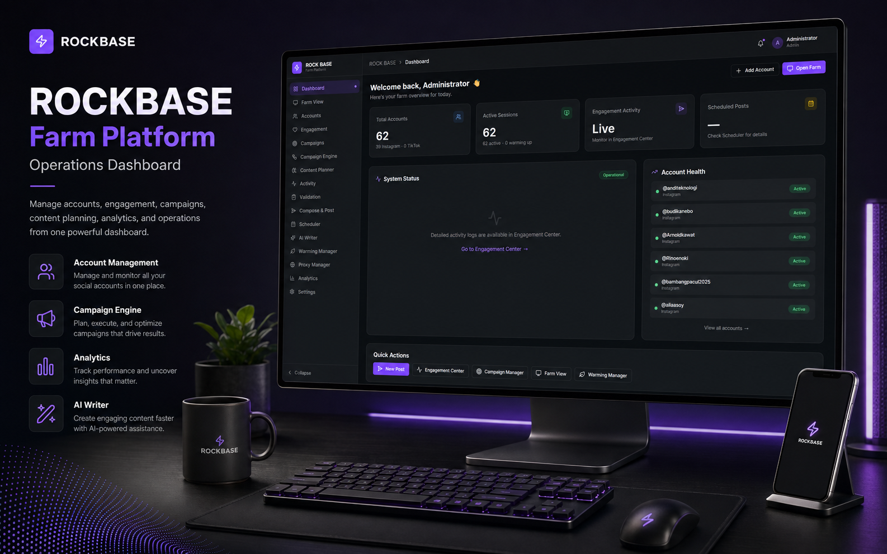
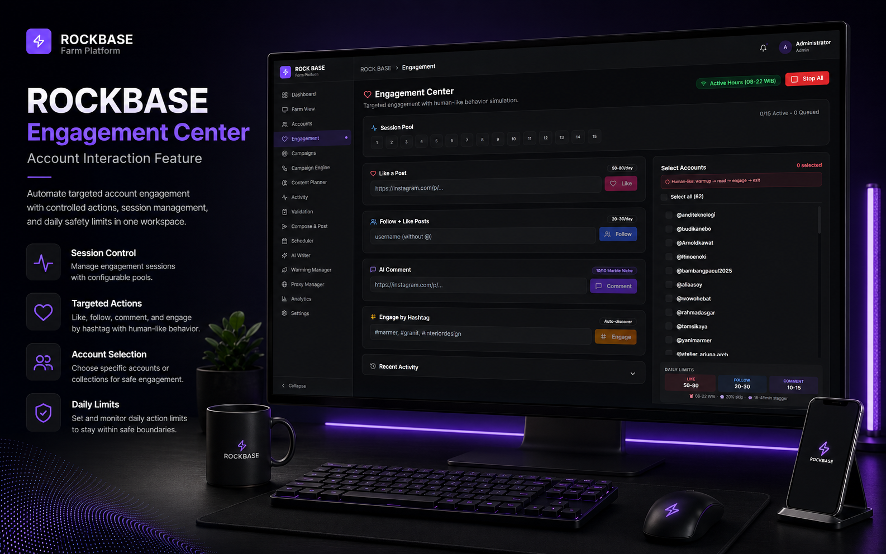
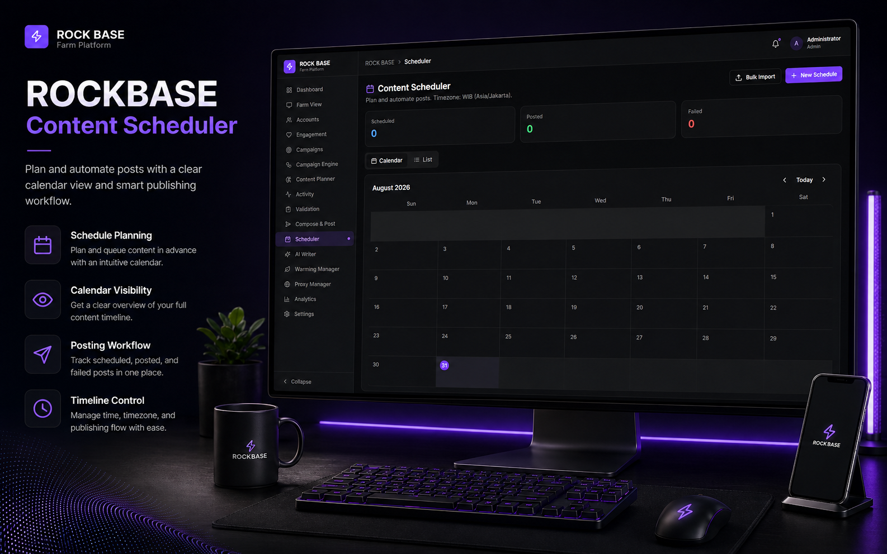
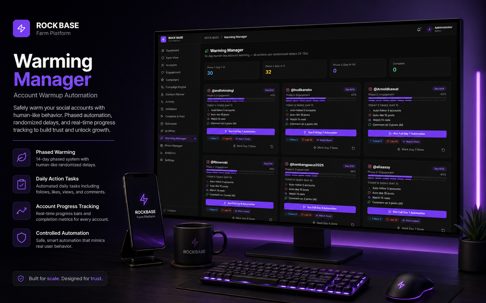

# ROCK BASE

> **Campaign operations for small teams and AI agents.**

[](LICENSE)


RockBase is a self-hosted campaign operations platform for teams that manage multiple social accounts.

Connect accounts once, keep reusable browser sessions, prepare campaigns with humans or AI agents, and let RockBase coordinate queued publishing, pacing, execution, session recovery, and operational status from one control plane.



```text
Prepare → Target → Queue → Publish → Monitor → Recover sessions when needed
```

## Product tour

| Dashboard | Engagement operations |
|---|---|
|  |  |
| Account/session health, campaign status, and quick actions in one operator view. | Bounded engagement operations with visible activity and account controls. |

| Content scheduler | Warming manager |
|---|---|
|  |  |
| Plan and review queued publishing work before execution. | Monitor optional account-warming work and manual attention requirements. |

> Screenshots show representative product surfaces. Social-platform login, 2FA, and any checkpoint/challenge remain manual operator work.

## Quick start

### Windows Local Mode — easiest

Best for one Windows operator on one workstation.

```bat
git clone https://github.com/ranggaoscar/rockbase.git
cd rockbase
START_ROCKBASE.bat
```

Open:

```text
http://127.0.0.1:5173
```

No RockBase login is required in Local Mode.

Then go to:

```text
Accounts → Farm View / Sessions → log in to a social account manually → Save Session
```

Local Mode prepares the native Node, Redis, Prisma, and Playwright runtime when needed. It is localhost-only and is not intended for LAN, phone, VPS, or public-hostname access.

### Server Mode — Docker

Best for teams, VPS deployments, and network-accessible installations.

```powershell
git clone https://github.com/ranggaoscar/rockbase.git
cd rockbase
powershell -ExecutionPolicy Bypass -File .\setup-rockbase.ps1
```

Then open:

```text
http://localhost:5173
```

Server Mode uses authenticated RockBase access. On a fresh installation, the setup flow prints a generated first administrator credential. For an existing installation, follow the dedicated [upgrade guide](docs/UPGRADE.md) instead of first-install steps.

## Why RockBase?

A small company may have one marketing operator, several salespeople, brand accounts, regional accounts, project accounts, and an AI agent—but not a large social media department.

RockBase gives that team a shared operational layer for campaign distribution. Humans and AI agents prepare the intent, content, and targets; RockBase owns session handling, queued account work, paced execution, and visibility into what needs attention.

RockBase does **not** create a fake audience. It operates social accounts that the team owns, manages, or is authorized to use.

## How to use RockBase

### 1. Start RockBase

- **Local Mode:** run `START_ROCKBASE.bat`
- **Server Mode:** use Docker with `setup-rockbase.ps1`

### 2. Add accounts

Open **Accounts** to add and organize account identities, platforms, status, and groups.

### 3. Open Sessions

Open **Farm View / Sessions**, choose an account, then:

1. open its browser session
2. log in to Instagram or TikTok manually
3. complete verification or 2FA when required
4. choose **Save Session**

RockBase login and social-platform login are separate. Local Mode removes RockBase dashboard login only; social account login remains human-controlled.

### 4. Create a campaign

Open **Campaigns** and prepare:

- content and caption
- target accounts or account groups
- execution intent

### 5. Monitor Queue

Use **Queue** to follow operational states:

```text
Queued → Running → Delayed → Completed
                    ↘ Needs attention / Failed
```

### 6. Resolve account attention

When a session needs attention, open it again in **Farm View / Sessions**, reconnect or complete verification, then save the refreshed session.

### 7. Review Activity

**Activity** provides campaign, publishing, and session operational history.

## Local Mode vs Server Mode

| | Local Mode | Server Mode |
|---|---|---|
| Best for | One Windows operator | Team, VPS, or network deployment |
| Start | `START_ROCKBASE.bat` | Docker Compose / `setup-rockbase.ps1` |
| RockBase login | No | Yes |
| Network | `localhost` only | Server deployment |
| URL | `http://127.0.0.1:5173` | Deployment URL; fresh Docker defaults to `http://localhost:5173` |
| Runtime | Native Node + Redis + Playwright prepared by launcher | Docker services |
| Data | Local repository/runtime paths | Persistent Docker volumes |
| Recommended for | Personal workstation / campaign operator | Shared team environment |

## Features

### Core

| Area | What it provides | Maturity |
|---|---|---|
| Accounts | Multi-account management, groups, platform/status fields, and session-health visibility | Core |
| Farm View / Sessions | Interactive Playwright browser, manual login and challenge handling, control/screenshots, Save Session, encrypted cookie persistence | Core |
| Campaigns | Campaign intent/content, account or group targeting, multi-account workflow | Core |
| Publishing Queue | Queued, running, delayed, completed, failed, and needs-attention operational states | Core |
| Quick Publish | Smaller or single publishing operations | Core |
| Activity | Campaign, publishing, and session operational history | Core |
| AI agent integration | Hermes/internal API for account discovery, media upload, campaign submission, and status/results without raw social cookies/passwords | Core boundary |
| Execution reliability | Account locks, posting budgets, durable idempotency, paced execution, Redis fail-closed behavior, ambiguous-delivery protection, restart reconciliation | Core |
| Backup / recovery | SQLite backup, checksums, and integrity validation | Core |

### Advanced / optional

| Area | Current role |
|---|---|
| Engagement | Optional operational tooling; not the primary product loop |
| Warming | Optional operational tooling |
| Proxy management | Optional runtime configuration |
| AI Writer | Optional drafting assistance; external agents remain the preferred content-generation layer |

### Experimental / not primary

| Area | Current role |
|---|---|
| Analytics | Not a trustworthy product-performance source yet |
| Content Planner | Secondary workflow surface |
| Campaign Engine panels | Experimental/advanced operational panels |
| Advanced scheduler recurrence | Not fully mature |

## Infrastructure

### Local Mode

```text
Human / AI agent
      |
RockBase Frontend
React + Vite
127.0.0.1:5173
      |
RockBase Backend
Express + TypeScript
127.0.0.1:3010
      |
 ┌────┼──────────────┐
 |    |              |
SQLite Redis/BullMQ Playwright Chromium
 |    |              |
data  queue/locks    account browser sessions
```

- **Frontend:** operator interface for Accounts, Sessions, Campaigns, Queue, and Activity.
- **Backend:** campaign, session, queue, and execution control plane.
- **SQLite:** accounts, campaigns, posts, activity, and encrypted session blobs.
- **Redis/BullMQ:** execution queue, locks, posting budgets, and runtime coordination.
- **Playwright Chromium:** interactive account browser sessions and supported browser-driven execution.

### Server Mode

```text
Browser / Operator
       |
Frontend container
       |
Backend API
       |
 ┌──────────┬────────────┐
SQLite      Redis/BullMQ Playwright
volume      redis-data   browser runtime

migrate service
      |
prisma migrate deploy
      |
backend starts
```

Persistent Docker volumes are preserved across normal upgrades:

```text
backend-db
backend-uploads
backend-backups
backend-logs
redis-data
```

Do not rename or delete these volumes during a normal upgrade.

## Where RockBase stores data

### Local Mode

| Data | Location |
|---|---|
| SQLite database | `backend/prisma/dev.db` |
| Configuration and encryption key | `backend/.env` |
| Uploads | `backend/uploads/` |
| Backups | `backend/backups/` |
| Logs | `backend/logs/` |
| Redis runtime data | `rockbase-data/redis/` |

### Server Mode

| Persistent volume | Purpose |
|---|---|
| `backend-db` | SQLite database, accounts, and encrypted saved sessions |
| `backend-uploads` | Uploaded/campaign media |
| `backend-backups` | Verified SQLite backup snapshots |
| `backend-logs` | Runtime logs |
| `redis-data` | Redis/BullMQ persistent state |

Social account sessions are currently stored as encrypted cookie data.

> **Recovery-critical:** a database backup without the original `ENCRYPTION_KEY` is not sufficient to recover encrypted account sessions. Preserve the database and the original key together. Do not print, expose, rotate, or replace saved cookies or secrets during normal operation.

## Security model

### Local Mode

- no RockBase dashboard login
- explicit `ROCKBASE_MODE=local`
- backend binds to `127.0.0.1`
- backend rejects non-loopback Local Mode requests

### Server Mode

- JWT authentication
- first-administrator bootstrap for fresh installs
- Docker/server deployment model

### Social accounts and AI agents

- social-platform login remains human-controlled
- saved cookies are encrypted
- AI agents do not normally receive raw social passwords or cookies
- Hermes/internal routes retain an independent token boundary

## Project status

**Current stage: `v0.1.0-alpha`**

The core campaign workflow is usable, but RockBase is not marketed as production-grade enterprise software. Browser-driven social connectors can require maintenance as platform UIs change.

## Current limitations

- social platform UI changes can break browser publishing selectors
- operators may need to reconnect expired sessions
- session persistence is encrypted cookies, not a complete browser profile
- login, 2FA, checkpoints, and challenges remain human-controlled
- analytics is not currently a trustworthy product-performance source
- advanced scheduler recurrence is not fully mature
- Local Mode is Windows-first
- Server/production upgrades require backup plus the [preflight and upgrade procedure](docs/UPGRADE.md)

## Documentation

- [Local Mode](docs/LOCAL_MODE.md) — localhost runtime, data paths, and graceful stop
- [Upgrade guide](docs/UPGRADE.md) — safe existing-installation upgrades
- [Production data contract](docs/PRODUCTION_DATA_CONTRACT.md) — session, volume, encryption-key, and recovery guarantees
- [Release checklist draft](docs/RELEASE_CHECKLIST_DRAFT.md) — alpha release preparation

## License

RockBase is licensed under the MIT License.

See [LICENSE](LICENSE).
